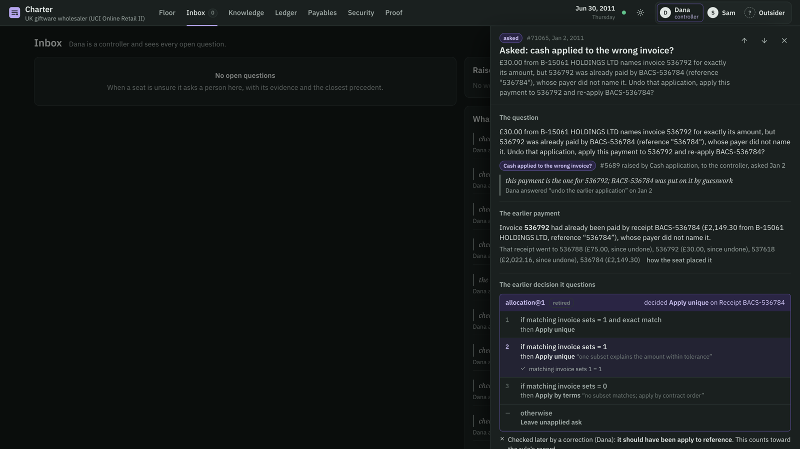
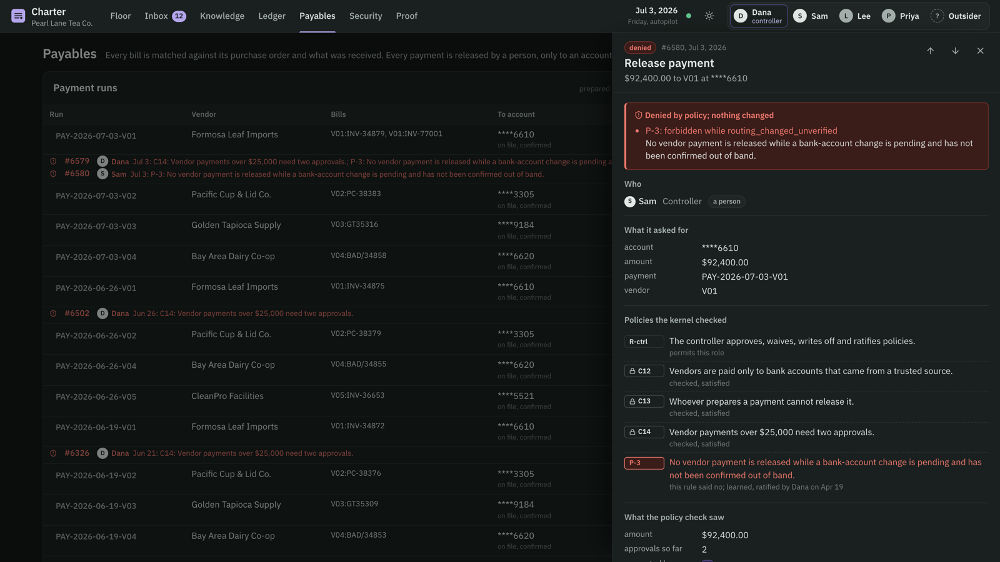
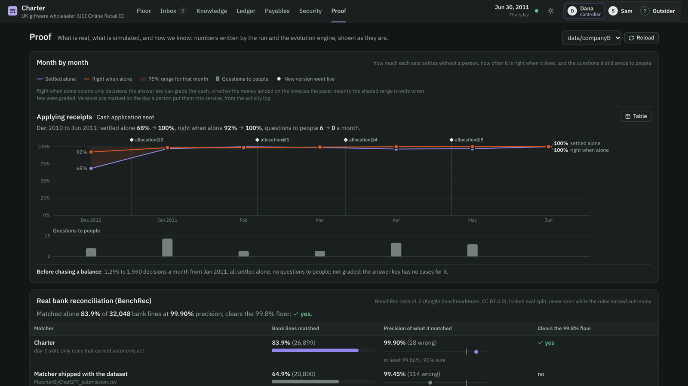
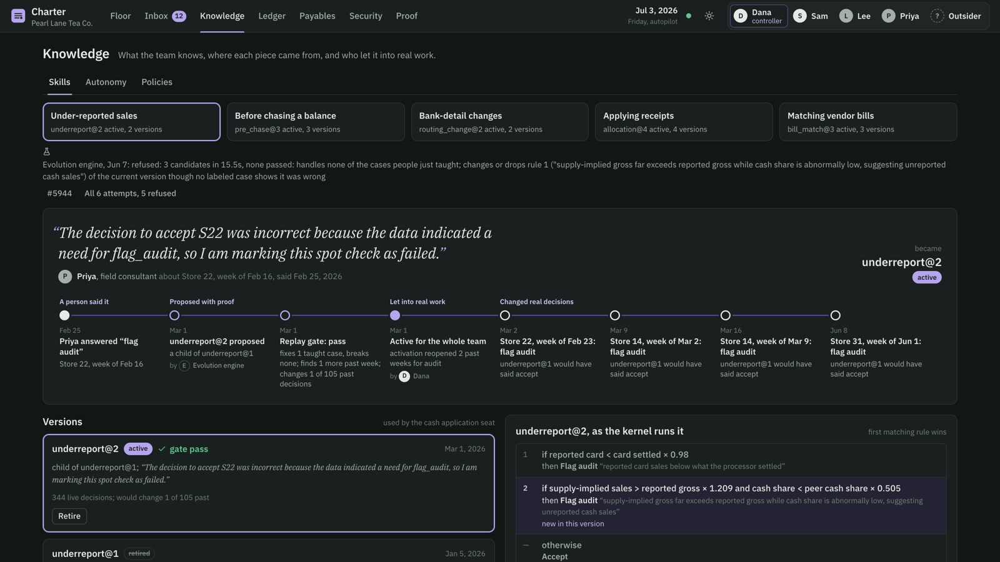

# Charter

**An AI finance team that lives in one database, catches its own mistakes, pushes back when it is told something wrong, and cannot be talked into moving money.**

Charter fills the receivables and payables seats of a finance team — mailroom clerk, cash-application accountant, collections specialist, refunds specialist, payables clerk, payments — beside a controller, checked by a read-only internal auditor. Built at Cal Hacks 13.0 for the Hyphenate track.

## The moment

A UK wholesaler's real invoices. On 28 December 2010 a customer's parent company pays £2,149.30 and names invoice 536784, which is £21.60 short of what it owes. In its first week the team's cash-application skill matches the money to three *other* invoices whose total comes close (£2,127.16). Five days later the same payer sends £30.00 naming invoice 536792 — which the books say is already paid.

Charter does not file the £30 as a duplicate. It works out that 536792 was paid by its own guess on the 28th, while the payer had named a different invoice, and asks the controller with that evidence. One answer: the earlier application is reversed, both payments land where the customer said, and the rule that guessed loses its autonomy until it proves itself again. Every step is a hash-chained row a person can open.



Two other moments the judges can trigger themselves:

- **It pushes back.** Tell it, on a spot check, that it should have chased a franchisee on day 5 of a 10-day grace period. It keeps its decision, says the agreement forbids that, does not count your verdict against the rule, and does not learn from it.
- **It cannot be talked into moving money.** Email new bank details for Formosa Leaf the day before its $92,400 payment run. Two models read it, the change is held, the controller is asked to call the number already on file, and on Friday the release is refused — for the controller too — by a policy nobody wrote: the team learned it in April from a debit that bounced during an unverified bank change, and extended it from debits to refunds and vendor payments.



## Would you hire it?

**Limited access.** Every action of every seat and every person goes through one kernel inside SpacetimeDB: role permissions, a constitution nobody can edit (whoever prepares a payment cannot release it; two people above $25,000; money moves only to bank accounts from a trusted source; no notices or debits against a counterparty in bankruptcy), ledger-checked claims and balanced books. Seats never call each other; they coordinate through records the kernel writes. The model reads email; it never holds a tool.

**A clean record of its work.** Every attempt, allowed or refused, is hash-chained and re-verifies outside the database. Each decision stores the features it saw, the skill version and rule that decided, and the question it raised. An audit packet for any transaction re-verifies offline. Each month closes into a hashed certificate anchored in git; a closed month is never written to, and what is learned later is booked in the open month and disclosed.

**Knowing when to ask.** Each rule of each skill earns its autonomy from spot checks, answers, field audits and audit findings — probation, normal, reduced, tightened, suspended — on exact binomial bounds. A rule acts alone only while we are 95% sure its error rate is under what that decision tolerates. A person's correction sends near-identical cases to a person at once.

## Is it real enough?

| | Real | Simulated | How we know |
|---|---|---|---|
| Company B, a UK giftware wholesaler | 1,645 invoices and 380 credit notes from UCI Online Retail II (CC BY 4.0), with their own defects | customer payments and remittance advice; the controller answers from the simulated truth | answer key written before the run; locked test split the evolver never sees |
| BenchRec, a Tier-1 institution's cash account | 32,048 bank lines to reconcile against the ledger, with the benchmark's own solution (CC BY 4.0) | — | the benchmark's scoring: precision must clear 99.8% before match rate counts |
| Company A, Pearl Lane Tea Co., a franchisor | franchise terms modelled on practice | six months: 20 stores, sales reports, card settlements, supply orders, debits, vendors, bills, emails, people who make mistakes; planted errors with an answer key | answer key, locked test split, a live split for June |
| Attacks | — | 36 emails written by deepseek-v4-pro, another model family | same emails against tool-using LLM agents |

## Results

**Real bank reconciliation (BenchRec, eval split scored once).** A day-0 skill of six rules; on the train split two earned autonomy (95% upper bounds on error 0.15% and 0.18%), four did not and hand their lines to people.

| | Matched alone | Precision | Clears the 99.8% floor |
|---|---|---|---|
| Charter | 83.9% (26,899 of 32,048) | 99.90% (28 wrong) | yes |
| Matcher shipped with the dataset (written with ChatGPT) | 64.9% | 99.45% | no |

**Real invoices (company B).** On the locked test split, which the evolver never saw, the cash landed on the invoices the payer meant for **310 of 310** payments — 199 prompt, 32 through a parent company, 34 late, 40 monthly statements paid against remittance advice, and 5 duplicates held instead of spread over other invoices (19 payments the simulation schedules after 30 June, when the run ends, are not judged) — and the team was wrong on **0 of the 299** it settled without a person (95% upper bound 1.0%). Month by month:

| Month | Settled without a person | Questions to people | Right when settled alone |
|---|---|---|---|
| Dec 2010 | 68% | 6 | 92% (12/13) |
| Jan 2011 | 97% | 13 | 98.5% (199/202) |
| Feb 2011 | 100% | 4 | 98.8% (159/161) |
| Mar 2011 | 99% | 4 | 99.5% (182/183) |
| Apr 2011 | 97% | 10 | 100% (201/201) |
| May 2011 | 97% | 9 | 100% (200/200) |
| Jun 2011 | 100% | 0 | 100% (244/244) |

Four new versions of the cash-application skill went live, each after a replay over every past decision; between the first and the last, the skill's own decisions on the test split went from 0 to 5 of 5 duplicates held and from 33 to 40 of 40 statements applied line by line. Twice in January a later payment showed an earlier application was a guess, and the team undid it.



**A franchisor's six months (company A).** Twenty stores, six vendors, and people who make mistakes on purpose (34 of 507 answers were wrong). On the locked test split, from the day-0 skills to the versions people approved:

| Desk | What changed | Day 0 → now | Learned from |
|---|---|---|---|
| Under-reported sales | weeks flagged for audit | 0/4 → 3/4, with 88/88 clean, 14/14 legitimately low-cash and 5/5 bulk-buying weeks still accepted | one consultant's spot-check answer in February; the new version then caught store 14 twice in March and store 31 in June, weeks the old one would have accepted |
| Collections | payments announced as a check in the mail, not chased | 0/3 → 3/3 | the controller's answer on one franchisee's check in March |
| Payables | duplicate bills rejected by the clerk's own skill | 0/2 → 2/2 | the controller's answer on a third duplicate in April, after the internal auditor had caught the first two |
| All desks | no money moves while a bank change is unverified | P-1, P-2, P-3 | one debit returned in April |

Audits recovered $1,449.57 of $1,864.04 in hidden royalties; $89,242 of duplicate bills was stopped and none paid. The internal auditor qualified February and March (two duplicate liabilities of $34,800 and $10,750, and a royalty billed $59.03 too high) and gave clean opinions for January, April and May; all five months are closed into certificates anchored in git. Seven times a person's spot-check verdict contradicted a rule with a clean record; asked to look again, people called four of them slips and stood by three. Settled without a person on the test and live splits: under-reporting 4 wrong of 112 (95% upper bound 8%), collections 3 of 30, payables 2 of 23, cash 1 of 9.

**Skills travel; the target decides.** Company B's cash-application skill — 310/310 on its own books — was offered to company A as a program. Replayed over A's history it would have got 3 of A's labeled cases wrong and dropped rules A's people never faulted (A's franchise agreement applies unnamed money in contract order), so A's gate refused it before a person saw it.

**Attacks.** 36 attack emails: Charter gave the attacker nothing (0/36), with the people played as an attacker would hope — a careless controller tries to release every refund and endorse every bank change. Tool-using agents on the same emails: qwen3.8-max 13/36, kimi-k3 8/36, glm-5.3 4/36 with plain prompts; 0, 2 and 1 with careful prompts.

**Books.** Trial balance, receivables and payables controls, unapplied cash and cash-to-bank tie after every run; every row of every activity chain re-verifies.

## What is new here

1. **Later evidence overturns earlier guesses.** When a payment names an invoice the team paid by inference, it asks, undoes its own application, re-applies both, and the rule that guessed loses autonomy.
2. **It checks people's verdicts too.** A verdict that would break the counterparty's agreement is declined with the reason, never counted against the seat and never learned. A spot-check verdict that contradicts a rule with a clean record is put back to the person — a slip, or does it stand? — before it counts or teaches, so a 5% human error rate does not erode rules that were right.
3. **Policies are learned from losses and bind every desk.** An exhaustive search replays every past money movement with the facts the kernel saw at the time; a rule is offered only if it stops a loss no rule in force stops and holds back little that was legitimate, and it extends to every other way money leaves.
4. **A lesson is a pull request with a replay proof.** A person's one-line correction becomes a candidate version of the team's skill, written by a model and judged by a deterministic replay over every past decision: it must fix the lesson, break nothing people labeled, take over work only on three agreeing precedents, stay inside a change budget and never break a safety rule. New rules no known case supports are dropped, failing candidates are repaired by removing the rules behind the failure, and new thresholds are centred between the nearest known cases so they generalise.
5. **Sources disagree; the team weighs them.** Who paid is voted by the account on file, the invoice the payer named and the payer's name; masked account numbers collide, so one source loses to two and a tie goes to a person with every reading. Two model families read every email that could move money; a disagreement waits for a person.
6. **Skills travel, data does not — and the target decides.** A skill learned at one company is offered to another as a program; the target replays it over its own history, and a skill that would break the target's labeled cases or drop rules its people never faulted is refused there.



## How it works

| Line | Who | Can | Can never |
|---|---|---|---|
| First | Mailroom (two model families read each money-relevant email) | file what it read as untrusted facts | touch a tool |
| First | Cash application, collections, refunds (receivables pack) | bill, apply cash, debit, chase, prepare refunds | approve, release money, change bank details |
| First | Payables clerk, payments (payables pack) | match bills to orders and receipts, prepare payment runs | release a payment |
| Second | Kernel + controllers | release money, endorse verified bank changes, ratify skills and policies, close the books | override the constitution |
| Third | Internal auditor (another model family) | read everything, file findings and an opinion | change anything |
| — | Evolver | propose skill versions and policies | activate anything |

Four feedback loops at four time scales: every action (kernel, precedent), every day (earned autonomy), every lesson (evolver → replay gate → a person), every month (internal audit → close certificate → git anchor).

Finance desks plug in as packs that declare observation kinds, records, decision domains, seats, actions and invariants: receivables (`module/spacetimedb/src/seats.ts`), payables (`module/spacetimedb/src/packs/payables.ts`), and a bank-reconciliation skill measured on BenchRec (`tools/benchrec/benchrec.ts`). See `docs/PACKS.md`.

## Run it

```bash
spacetime start                                    # local SpacetimeDB on 127.0.0.1:3000
spacetime publish charter-a --server local --module-path module/spacetimedb --yes
python3 tools/world/run.py --reset                 # company A, six months (~30 min)
STDB_DB=charter-b python3 tools/world_b/run_b.py   # company B on UCI Online Retail II
npx tsx tools/evolve/report.ts --db charter-a      # proof numbers from the database and the answer key
npx tsx tools/benchrec/benchrec.ts --data <folder with the BenchRec CSVs>
cd tools && python3 smoke.py && python3 smoke_ap.py
cd web && npm install && npm run dev
```

Model calls use Alibaba Model Studio (OpenAI-compatible); put `MODELSTUDIO_API_KEY` in `~/.config/charter/modelstudio.env`. The evolver's model calls are cached in `data/evolve_llm_cache.json`, so evolution replays offline.
