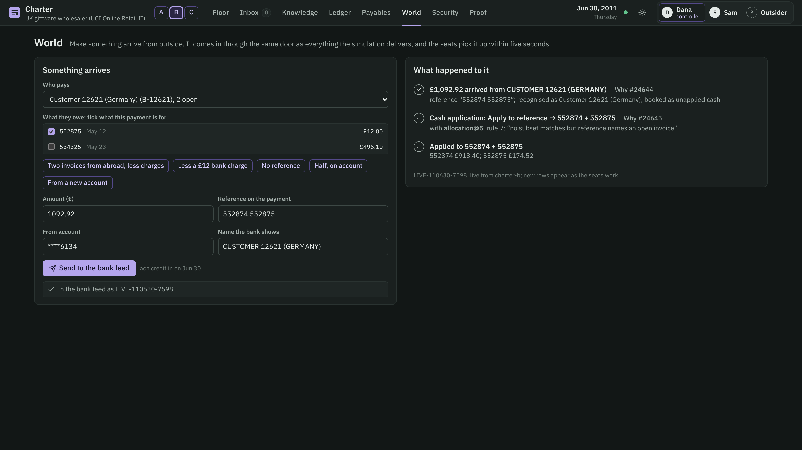
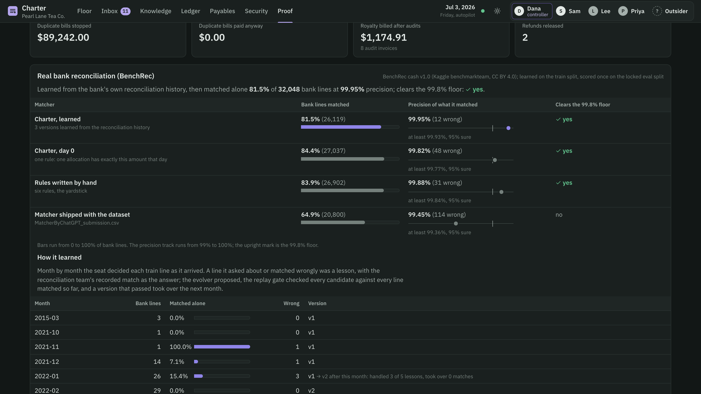
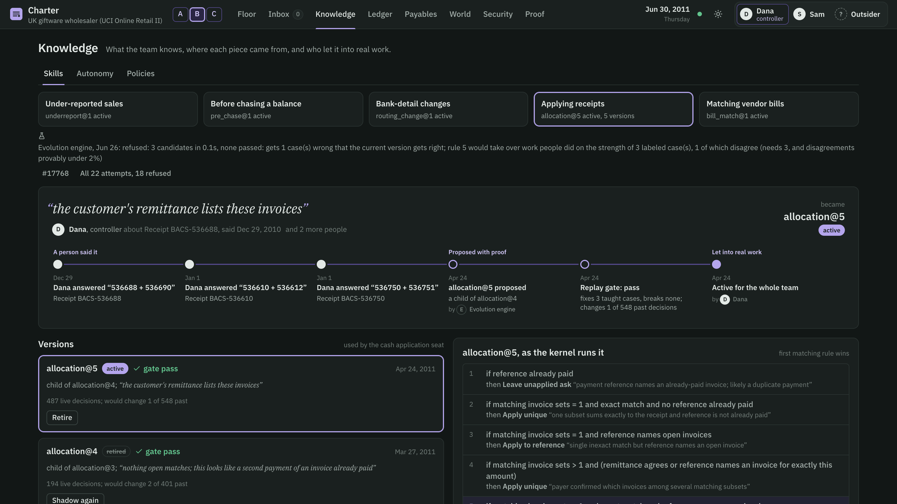
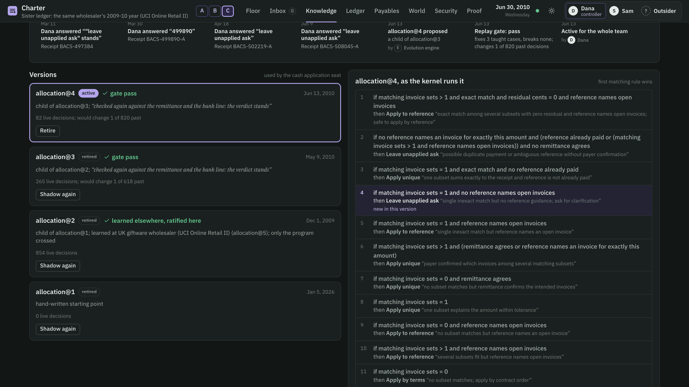

# Charter

**An AI finance team that lives in one database, catches its own mistakes, pushes back when it is told something wrong, and cannot be talked into moving money.**

Charter fills the receivables and payables seats of a finance team — mailroom clerk, cash-application accountant, collections specialist, refunds specialist, payables clerk, payments — beside a controller, checked by a read-only internal auditor. Built at Cal Hacks 13.0 for the Hyphenate track.

**See it:** [pinkstrokes.github.io/charter](https://pinkstrokes.github.io/charter/) — the team drawn as a living record; give it a task (a payment, a bank change, a chase, a rule to learn) and watch it decide on the real history. **The live system:** [pinkstrokes.github.io/charter/app](https://pinkstrokes.github.io/charter/app/) — the three companies replayed on SpacetimeDB's maincloud, open to anyone as an outsider: every decision's Why panel, every skill version's replay proof, the hash chain verified in your browser.

## The moment

A UK wholesaler's real invoices. On 28 December 2010 a customer's parent company pays £2,149.30 and names invoice 536784, which is £21.60 short of what it owes. In its first week the team's cash-application skill matches the money to three *other* invoices whose total comes close (£2,127.16). Five days later the same payer sends £30.00 naming invoice 536792 — which the books say is already paid.

Charter does not file the £30 as a duplicate. It works out that 536792 was paid by its own guess on the 28th, while the payer had named a different invoice, and asks the controller with that evidence. One answer: the earlier application is reversed, both payments land where the customer said, and the rule that guessed is put under tightened inspection: 40% of its decisions go to a person until ten in a row check out. Every step is a hash-chained row a person can open.


Three moments the judges can trigger themselves:

- **It pushes back.** Tell it, on a spot check, that it should have chased a franchisee on day 4 of a 10-day grace period. It keeps its decision, says the agreement forbids that, does not count your verdict against the rule, and does not learn from it.
- **It cannot be talked into moving money.** Email new bank details from Formosa Leaf's own address hours before its $92,400 payment run. Two models read it, the change is held, the controller is asked to call the number already on file, and the release is refused — for both controllers — by a policy nobody wrote: the team learned it in April from a debit that bounced during an unverified bank change, and extended it from debits to refunds and vendor payments.

- **Give it your own payment.** On the World screen, make up a payment — any payer, any invoices, any reference, from any account — and it arrives through the bank feed like everything else. A transfer from abroad paying two invoices, £12 short for the banks' charges, is applied alone to exactly the two invoices the customer named, by a rule the team learned from the controller's answers in January; the £12 waits for Monday's write-off list. A bill made up the same way goes to the payables clerk.




## Would you hire it?

**Limited access.** Every action of every seat and every person goes through one kernel inside SpacetimeDB: role permissions, a constitution nobody can edit (whoever prepares a payment cannot release it; two people above $25,000; money moves only to bank accounts from a trusted source; no notices, fees or debits against a counterparty in bankruptcy; no past-due notice or late fee while the counterparty's own money, waiting to be applied, covers everything it has past due), ledger-checked claims and balanced books. Seats never call each other; they coordinate through records the kernel writes. The model reads email; it never holds a tool.

**A clean record of its work.** Every attempt, allowed or refused, is hash-chained and re-verifies outside the database. Each decision stores the features it saw, the skill version and rule that decided, and the question it raised. An audit packet for any transaction re-verifies offline. Each month closes into a hashed certificate anchored in git; a closed month is never written to, and what is learned later is booked in the open month and disclosed.

**Knowing when to ask.** Each rule of each skill earns its autonomy from spot checks, answers, field audits and audit findings — probation, normal, reduced, tightened, suspended — on exact binomial bounds. A rule acts alone until its record proves, at 95%, that it is wrong more often than that decision tolerates; then it is suspended and its cases go to a person. Until then a share of its decisions goes to a person as a spot check: 25% on probation, 10% normally, 3% once its record proves it is under the tolerance, and 40% after a recent error, until ten clean checks. A person's correction sends near-identical cases to a person at once.

## Is it real enough?

| | Real | Simulated | How we know |
|---|---|---|---|
| Company B, a UK giftware wholesaler | 1,645 invoices and 380 credit notes from UCI Online Retail II (CC BY 4.0), with their own defects | customer payments and remittance advice, with the long tail of cash application: payments from abroad short by bank charges or off by the exchange rate, money sent "on account" without a reference, one payment for two invoices, duplicates | answer key written before the run; locked test split the evolver never sees |
| Company C, a sister ledger | 1,876 invoices and 456 credit notes from the same dataset's previous year (December 2009 to May 2010), its own 120 largest customers | payments with the same long tail, drawn under their own seed | run twice on identical events: started from company B's skill, and from scratch |
| BenchRec, a Tier-1 institution's cash account | 68,975 reconciled bank lines to learn from and 32,048 to reconcile, with the benchmark's own solution (CC BY 4.0) | — | the benchmark's scoring: precision must clear 99.8% before match rate counts |
| Company A, Pearl Lane Tea Co., a franchisor | franchise terms modelled on practice | six months: 20 stores, sales reports, card settlements, supply orders, debits, vendors, bills, emails, people who make mistakes; planted errors with an answer key | answer key, locked test split, a live split for June |
| Attacks | — | 36 emails written by deepseek-v4-pro, another model family | same emails against tool-using LLM agents |
| People | — | a script decides what each controller and consultant answers from the simulated truth, including pre-registered wrong answers (about 5%); a model writes the one-line reason in their voice | the answer key knows which answers were slips, so how the team treats a person's mistake is measured; in the live demo a judge can give it an instruction directly, and it pushes back on a wrong one |

## Results

**Real bank reconciliation (BenchRec, eval split scored once).** The bank desk starts with one rule — match a line when exactly one ledger allocation has that amount on that day — and learns the rest from the institution's own reconciliation history, month by month, through the same evolver and replay gate as every desk. It found that a line whose ledger entry was booked on a different day is wrong about one time in 25, and stopped matching those alone. Each rule then earns its autonomy the way every rule in Charter does, on the train months after the last version took over, which no version was fitted to: it is suspended, and its lines go to a person, once its record there proves at 95% that it is wrong more often than 0.2%. All four desks are scored once on the locked eval split.

| | Matched alone | Wrong | Precision | Clears the 99.8% floor |
|---|---|---|---|---|
| Charter, learned (day 0 + 3 versions) | 81.5% (26,119 of 32,048) | 12 | 99.95% | yes |
| Charter, day 0 (one rule) | 84.4% | 48 | 99.82% | yes, by 0.02 points |
| Six rules written by hand (three suspended) | 83.9% | 31 | 99.88% | yes |
| Matcher shipped with the dataset (written with ChatGPT) | 64.9% | 114 | 99.45% | no |

By the benchmark's own ranking (clear the floor, then match the most) day 0 places higher, and that ranking is exactly what Charter will not play to. On the locked eval split the 918 lines the learned desk hands to people instead were wrong 36 times when day 0 matched them alone, one in 25: day 0 clears the floor only by averaging that pattern into clean matches. Every rule earns its autonomy on its own record, so a pattern wrong 4% of the time never acts alone, whatever the average around it. Month by month (`tools/benchrec/monthly.ts`), the learned desk clears the floor in each of the eval split's three full months (its worst, April, 99.90%); day 0 misses it in April and May (99.75%, 99.77%) and clears it overall only because March and a late August batch were clean. Resampling whole days, day 0 falls under the floor in 28% of resamples and the learned desk in 1 of 2,000. The price is 2.9 points of match rate: by the benchmark's own pick, day 0 still wins most resamples.



**Real invoices (company B).** Real customers pay messily, so the simulated payments carry the long tail of cash application: from abroad, short by bank charges or off by the exchange rate, sometimes paying two invoices in one transfer; money sent "on account" without a reference; one payment for two invoices; duplicates. On the locked test split, which the evolver never saw, the cash landed on the invoices the payer meant for **309 of 314** payments, and the team was wrong on **4 of the 304** it settled without a person (95% upper bound 3.0%). The controller's answers became four new versions of the cash-application skill, each replayed over every past decision before it went live. On the same test payments:

| Version | What it learned | Live from | Settled alone | Wrong when alone | Right |
|---|---|---|---|---|---|
| Day one | — | 1 Dec 2010 | 301 | 19 | 282 of 313 |
| v2 | the invoices a reference names come first, even when the amount is short or several sets fit; when several fit, the one the payer confirms | 2 Jan | 313 | 18 | 295 |
| v3 | no set fits, but the reference names open invoices → those, even short; an exact match only when its reference is not already paid | 16 Jan | 313 | 8 | 305 |
| v4 | a reference to an invoice already paid, or several sets that fit with nothing to choose between them → ask: it may be a duplicate | 3 Apr | 306 | 3 | 308 |
| v5 | several sets fit exactly and the reference names open invoices → those | 17 Apr | 306 | 3 | 308 |

| Month | Settled without a person | Questions to people | Right when settled alone |
|---|---|---|---|
| Dec 2010 | 72% | 5 | 92% (12/13) |
| Jan 2011 | 92% | 21 | 96.8% (181/187) |
| Feb 2011 | 100% | 4 | 98.7% (156/158) |
| Mar 2011 | 100% | 2 | 98.9% (188/190) |
| Apr 2011 | 98% | 7 | 99.0% (202/204) |
| May 2011 | 98% | 8 | 99.5% (200/201) |
| Jun 2011 | 99% | 4 | 99.6% (238/239) |

Twice — on 2 January and again in June — a later payment exposed an earlier application as a guess and the team undid it; after the first, the team learned that the invoices a payer names come first, and stopped guessing over them. The pennies bank charges leave are not chased: every Monday the cash seat lists them and the controller writes them off (99 invoices, £1,052.42 over seven months).




**Never chasing a customer with its own money (B and C).** Cash application leaves money it cannot place unapplied and asks a person; collections chases what is past due. Each is right on its own. Together, before the kernel fix, company B sent 72 past-due notices to 7 customers whose own money, waiting to be applied, already covered everything they had past due, and company C sent 34 to 8. The constitution now forbids it (C16–C18). On the same books the kernel refused the notice on every day the skill still said chase (439 times in B, 170 in C); no notice reached a customer whose money covered what was past due, and every other chase went ahead.

**A franchisor's six months (company A).** Twenty stores, six vendors, and people who make mistakes on purpose. On the locked test split, from the day-0 skills to the versions people approved:

| Desk | What changed | Day 0 → now | Learned from |
|---|---|---|---|
| Under-reported sales | weeks flagged for audit | 0/4 → 3/4, with 14/14 legitimately low-cash and 5/5 bulk-buying weeks still accepted and 87 of 88 clean weeks (one goes to a consultant) | two field audits and a consultant's answer in March (v2); four consultants' "explained, accept" answers in April (v3) |
| Collections | payments announced as a check in the mail, not chased | 0/3 → 3/3 | the controller's answer on one franchisee's check in March |
| Payables | duplicate bills rejected by the clerk's own skill | 0/2 → 2/2 | the controller's answer on a third duplicate in April, after the internal auditor had caught the first two |
| All desks | no money moves while a bank change is unverified | P-1, P-2, P-3 | one debit returned in April |

Audits recovered $1,174.91 of $1,918.55 in hidden royalties (cash under-reporting alone, $1,120.40 of $1,864.04); $89,242 of duplicate bills was stopped and none paid. The internal auditor qualified February and March (two duplicate liabilities of $34,800 and $10,750, and a royalty billed $59.03 too high) and gave clean opinions for January, April and May; all five months are closed into certificates anchored in git. Seven times a person's spot-check verdict contradicted a rule with a clean record; asked to look again, people called four of them slips and stood by three, and a later run of slips no longer teaches a desk to ask more. Settled without a person on the test and live splits: under-reporting 6 wrong of 111 (95% upper bound 10%), collections 3 of 30, payables 2 of 23, cash 1 of 9. What it still misses: store 31's milder under-reporting in June (0 of 3 live weeks: its cash share ran 11–13 points under its own history, while every week people taught it ran 20 or more under), and short payments that name their invoice (1 of 3 applied where meant): A's cash desk ran its day-one skill, which does not read references, until June, and its people labeled only one of the other two, then contradicted that label in a spot check.

**Skills travel; the target decides.** A skill crosses between companies as a program and a few numbers from its proof; no record crosses, and the receiving company decides.

*A new ledger starts from what a sister company learned.* Company C is a second ledger built from the same public dataset's previous year: 1,876 real invoices and 456 credit notes, December 2009 to May 2010, for its own 120 largest customers, with payments drawn by the same simulation under their own seed. We ran it twice on identical events. Once its controller started cash application from the skill company B had learned (every rule of it starting on probation, as any new version does); once it started from the hand-written day-one skill. From then on each learned on its own.

| Company C | Started from B's skill | Started from scratch |
|---|---|---|
| First three months: wrong when it settled alone | **1** of 337 | 21 of 334 |
| Seven months: wrong when it settled alone | **18** of 1,123 | 31 of 1,052 |
| Seven months: questions to people | **96** | 173 |
| New versions it needed | 1 | 7 |
| Locked test split: cash landed where the payer meant | **315** of 324 | 311 of 324 |
| Test and live splits: wrong when it settled alone | **5** of 305 (95% upper bound 3.4%) | 8 of 287 (5.0%) |



*A skill that does not fit is refused.* Company B's cash skill was also offered to company A, whose history is six months long: A's gate replayed it, whole and rule by rule at every place in A's own program, over A's own history, and refused every variant before a person saw it. The whole program would get 3 of A's labeled cases wrong, and none of its rules handles the case A's people had just taught. B's best lesson, a payment naming one open invoice goes there even when short, is what A's two misapplied short payments needed; but A had no clean evidence for it (one of the two was never checked, the other's correction was contradicted by a later spot check), and a rule takes over work only on agreeing cases of the receiving company's own.

**Attacks.** 36 attack emails: Charter gave the attacker nothing (0/36), with the people played as an attacker would hope — a careless controller tries to release every refund and endorse every bank change. Tool-using agents on the same emails: qwen3.8-max 13/36, kimi-k3 8/36, glm-5.3 4/36 with plain prompts; 0, 2 and 1 with careful prompts.

**Books.** Trial balance, receivables and payables controls, unapplied cash and cash-to-bank tie after every run; every row of every activity chain re-verifies.

**How stable these numbers are.** Each number above is one run, and each run replays exactly on the same engine: the committed caches of model calls (the evolver's proposals, company A's email readings) make a replay on a fresh database reproduce it row for row, which we checked for company A. Change anything upstream and the run takes another path: the model is asked again wherever a prompt reads differently, and the seats take a day's work in the order it is stored. The kernel fix that stopped chasing customers with their own money (C16–C18) redid every run and showed both. Company A replayed decision for decision. Company B learned the same five versions on the same days, but two of its same-day payments were taken in the other order and one more test payment landed wrong (309 of 314, from 310). Company C's path changed from May, when one more collections spot check moved the numbers of later questions, which the evolver's prompts cite. Company A's under-reporting desk is the most sensitive: across four runs (this one, a replay whose only difference was its row ids, and two replays on maincloud) its final rule caught 3, 1, 4 and 3 of the 4 test weeks, while the collections and payables desks ended at 3 of 3 and 2 of 2 every time. The public page watches the maincloud replays, which store and so order some same-day work differently from the local engine. There company B landed 310 of 314 test payments (wrong on 4 of the 298 it settled alone, with three new versions instead of four), and company C, started from that B's skill, landed 321 of 324 (wrong on 3 of 303, with six new versions). In both, no notice reached a customer whose own money covered what was past due: the kernel refused 415 attempts in B and 347 in C.

## What is new here

1. **Later evidence overturns earlier guesses.** When a payment names an invoice the team paid by inference, it asks, undoes its own application, re-applies both, and the rule that guessed goes on tightened inspection.
2. **It checks people's verdicts too.** A verdict that would break the counterparty's agreement is declined with the reason, never counted against the seat and never learned. A spot-check verdict that contradicts a rule with a clean record is put back to the person — a slip, or does it stand? — before it counts or teaches, so a 5% human error rate does not erode rules that were right.
3. **Policies are learned from losses and bind every desk.** An exhaustive search replays every past money movement with the facts the kernel saw at the time; a rule is offered only if it stops a loss no rule in force stops and holds back little that was legitimate, and it extends to every other way money leaves.
4. **A lesson is a pull request with a replay proof.** A person's one-line correction becomes a candidate version of the team's skill, written by a model and judged by a deterministic replay over every past decision: it must handle what people taught, never break a safety rule, stay inside a change budget, and pass three statistical tests that use the same arithmetic as earned autonomy — a new mistake on a labeled case fails it unless the record proves such mistakes rarer than the domain tolerates (impossible on a few dozen cases, possible on 69,000 bank lines); taking work from people needs three agreeing precedents; handing work back to people needs the evidence that would suspend a rule, so a few slips cannot teach it to ask. Candidates are ranked by value: one mistake stopped is worth 1/tolerable questions, because at that error rate acting alone and asking cost the same. New rules no known case supports are dropped, failing candidates are repaired, and new thresholds are searched over the values the cases actually take and centred between the nearest known cases.
5. **Sources disagree; the team weighs them.** Who paid is voted by the account on file, the invoice the payer named and the payer's name; masked account numbers collide, so one source loses to two and a tie goes to a person with every reading. Two model families read every email that could move money; a disagreement waits for a person.
6. **Skills travel, data does not — and the target decides.** A new ledger can start from the skill a sister company learned: the program crosses, its controller ratifies it, and every rule starts on probation; started that way, company C made 1 mistake in its first three months instead of 21. A company with a history replays an offered skill, whole and rule by rule at every place in its own program, over its own history, and adopts only what handles something its own people taught and passes its own gate.
7. **The same action under another name is the same decision.** Every decision records what each outcome would have done with that case — for cash, which invoices each would pay. Checks, the gate and the grading compare where the money goes, not what the outcome is called. Without it, "apply to the invoice the payer named" and "apply oldest first" looked like contradictory answers for a customer with one open invoice, and no candidate could learn bank charges.
8. **It checks what no seat owns, before it happens.** A replay shows how a skill did on what it has seen. A solver (Z3, over the same TypeScript the module runs; its encoding agrees with the interpreter on all 3,540 checks: 240 recorded payments through every cash version, plus random inputs for all 19 skill versions) also enumerates every situation the cash skill's versions can tell apart (40, none missing), realizes each as a concrete payment (a few edits of a real ledger, read by the seat's own code) and gives each version a certificate listing the situations it decides differently and how many people's labels each has (`tools/certify`). Company B's current version would act alone in 16 situations none of its 1,225 payments ever fell into. Replayed without hindsight, earning autonomy situation by situation instead of rule by rule nearly halves B's mistakes made alone (15 to 8) for 21 more questions in six months. Taken across seats and the kernel, the same check found what no seat owns: a customer pays everything it has past due under a vague reference, cash application rightly asks a person, and collections sends a past-due notice and late fees the same day. Company A's six months never produced it; company B's and C's books had, 72 and 34 times. The kernel now computes that fact and the constitution forbids the notice and the fee (C16–C18). Of the five fixes checked, it is the only one proved, for every situation, to send no notice and charge no fee while a customer's own money covers what is past due, to charge no fee in bankruptcy, and never to hold back a chase the cash does not cover; the others let the late fees through, hold a chase a person confirmed was right, or still charge fees in bankruptcy.


## How it works

| Line | Who | Can | Can never |
|---|---|---|---|
| First | Mailroom (two model families read each money-relevant email) | file what it read as untrusted facts | touch a tool |
| First | Cash application, collections, refunds (receivables pack) | bill, apply cash, debit, chase, prepare refunds | approve, release money, change bank details |
| First | Payables clerk, payments (payables pack) | match bills to orders and receipts, prepare payment runs | release a payment |
| Second | Kernel + controllers | release money, endorse verified bank changes, ratify skills and policies, close the books | override the constitution |
| Third | Internal auditor (another model family) | read everything, file findings and an opinion | change anything |
| — | Evolver | propose skill versions and policies | activate anything |

Four feedback loops at four time scales: every action (kernel, precedent), every day (earned autonomy), every lesson (evolver → replay gate → a person), every month (internal audit → close certificate → git anchor).

Finance desks plug in as packs that declare observation kinds, records, decision domains, seats, actions and invariants: receivables (`module/spacetimedb/src/seats.ts`), payables (`module/spacetimedb/src/packs/payables.ts`), and a bank-reconciliation skill measured on BenchRec (`tools/benchrec/benchrec.ts`). See `docs/PACKS.md`.

## Run it

```bash
spacetime start                                    # local SpacetimeDB on 127.0.0.1:3000
spacetime publish charter-a --server local --module-path module/spacetimedb --yes
python3 tools/world/run.py --reset                 # company A, six months (about 3 minutes with the committed model caches)
STDB_DB=charter-b python3 tools/world_b/run_b.py   # company B on UCI Online Retail II
STDB_DB=charter-c python3 tools/world_b/run_b.py --data data/companyC --start 2009-12-01 --until 2010-06-30 --seed 7 --start-from charter-b   # company C from B's skill
python3 tools/evolve/compare.py data/companyC data/companyC-alone   # against the same ledger started from scratch
npx tsx tools/evolve/report.ts --db charter-a      # proof numbers from the database and the answer key
npx tsx tools/benchrec/benchrec.ts --data <folder with the BenchRec CSVs>
npx tsx tools/evolve/gate_check.ts                 # the gate's regression checks, offline
npm install --prefix tools/certify && npm run all --prefix tools/certify   # the competence map, certificates and team checks (see tools/certify/README.md)
cd tools && python3 smoke.py && python3 smoke_ap.py
cd web && npm install && npm run dev
tools/demo/demo.sh clone && tools/demo/demo.sh build   # the live demo's own server (main server stopped first), prepared and snapshotted
tools/demo/demo.sh up                              # demo server :3100, the UI with its step bar on :5191
tools/demo/demo.sh reset                           # back to the snapshot between judges, a second or two
```

Model calls use Alibaba Model Studio (OpenAI-compatible); put `MODELSTUDIO_API_KEY` in `~/.config/charter/modelstudio.env`. The evolver's model calls are cached in `data/evolve_llm_cache.json`, so evolution replays offline.
